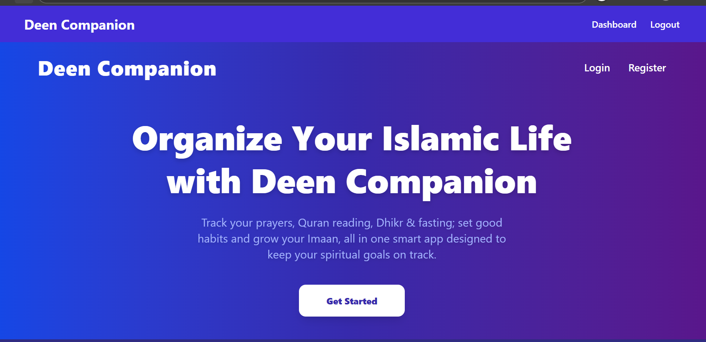
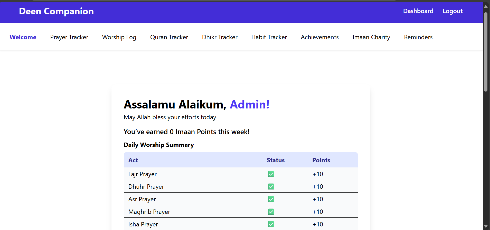
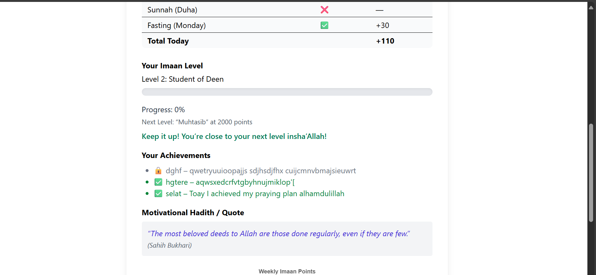
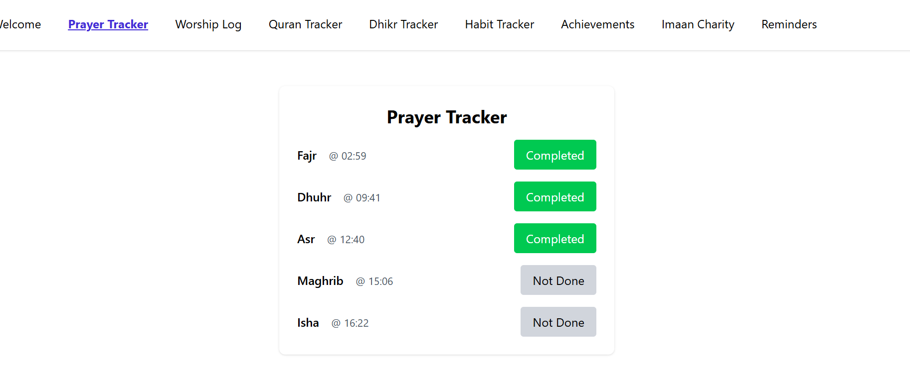
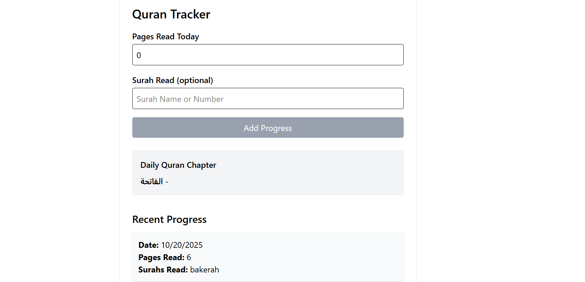
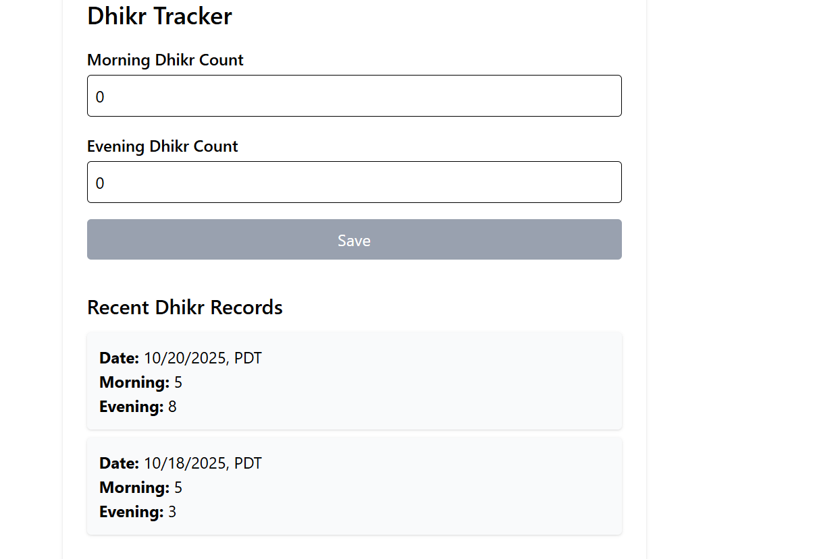
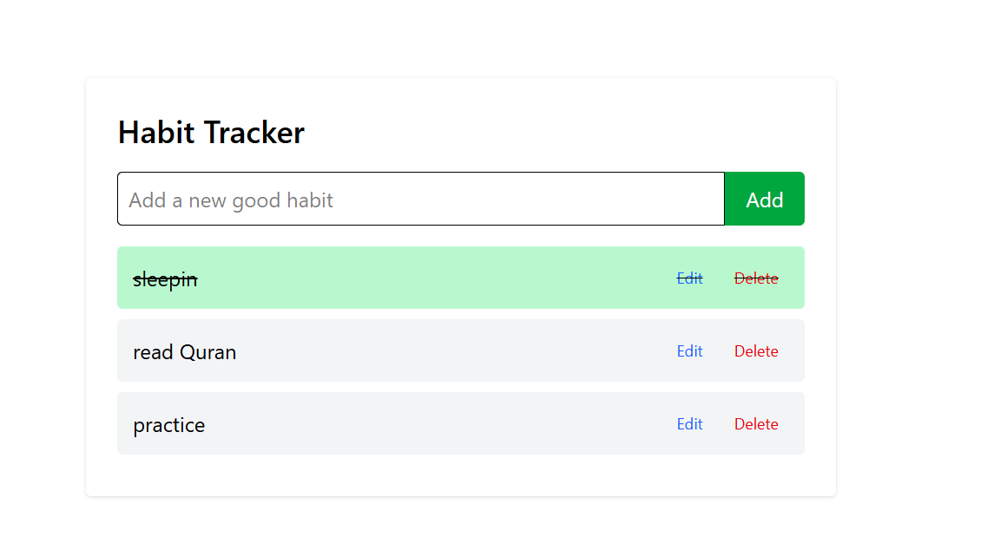
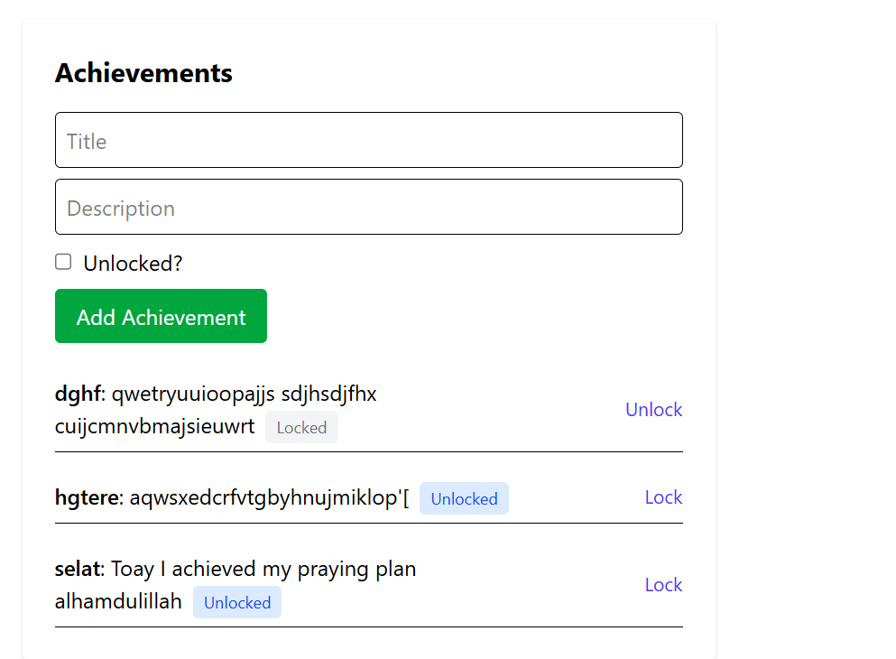
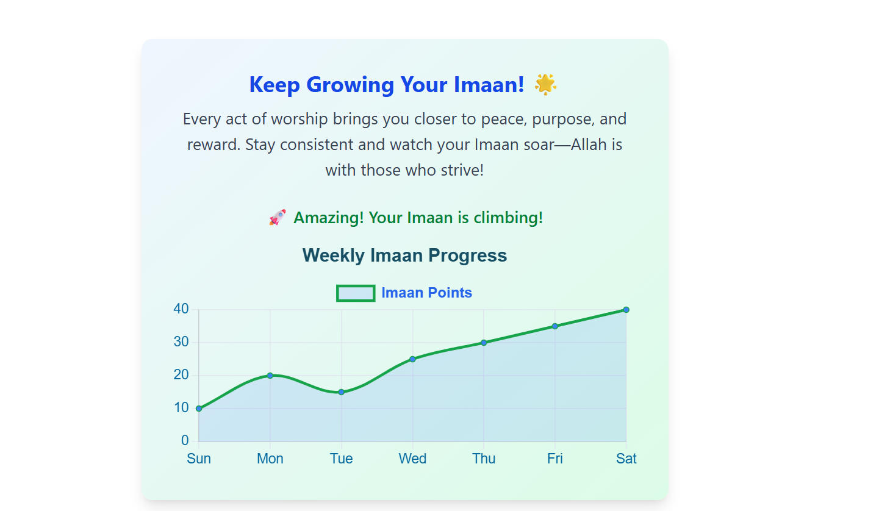
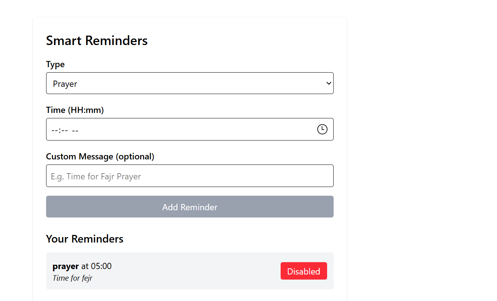

# Deen_Companion🌙 Deen Companion
A spiritual habit‑tracking and Qur’an engagement web app built with the MERN stack.

🧭 Overview
Deen Companion is a comprehensive spiritual tracking application designed to help Muslims strengthen their daily connection with Allah.
It lets users track prayers, dhikr, Qur’an reading, fasting, and sunnah habits while offering elegant progress visuals like the ImaanChart, inspirational messages, and weekly analytics.

Built using the MERN Stack (MongoDB, Express, React, Node.js), it delivers a seamless full‑stack experience with authentication, insightful dashboards, and consistent spiritual reminders.

🧭 Features
🕌 Prayer Logging — Track daily Salah with completion status.

📿 Dhikr Counter — Morning, evening, and custom adhkar.

📖 Qur’an Progress Tracker — Record pages and surahs read.

❤️ Habit Builder — Create and maintain good deeds.

🔔 Reminders — Custom alerts for Salah, Sunnah, or reflection.

📈 ImaanChart Dashboard — Dynamic weekly analytics with motivational insights.

🌙 Qur’an API Integration — Authentic content from Quran.Foundation.

🔒 JWT Authentication — Secure your account and data with token protection.

Modern React UI – Built with TailwindCSS for smooth responsiveness.

🧩 Tech Stack
Category	Technology
Frontend	React.js, React Router, Axios, Chart.js (ImaanChart)
Backend	Node.js, Express.js
Database	MongoDB with Mongoose ODM
Auth	JWT (JSON Web Token)
APIs Used	Quran.Foundation API, AlAdhan Prayer Times API
Styling	TailwindCSS
Dev Tools	Nodemon, dotenv, React DevTools
          📚 Folder Structure
          

 Deen_Companion/
│
├── backend/
│   ├── controllers/      # Business logic (prayers, dhikr, quran, reminders)
│   ├── middleware/       # Authentication & error handling
│   ├── models/           # Mongoose schemas
│   ├── routes/           # REST API endpoints
│   ├── services/         # Helper methods for database logic
│   └── server.js         # Main entry point
│
├── frontend/
│   ├── src/components/   # React components (ImaanChart, trackers)
│   ├── src/pages/        # Dashboard, Login, Register, etc.
│   └── src/App.js        # Root component
│
└── .env                  # Environment variables


⚙️ Installation & Setup
Prerequisites
Ensure you have the following installed:

Node.js (v18+)

MongoDB (Local or Cloud via MongoDB Atlas)

npm or yarn

Steps
 # Clone repository
git clone https://github.com/Sofi3406/Deen_Companion.git
cd Deen_Companion

# Install dependencies
cd backend && npm install
cd ../frontend && npm install
  
  Environment Variables
Create a .env inside backend/:

MONGO_URI=mongodb://localhost:27017/deencompanion
JWT_SECRET=Deen_Companion_Secret_Key
PORT=5000

# Quran Foundation API
QURAN_CLIENT_ID=your_client_id
QURAN_CLIENT_SECRET=your_client_secret
QURAN_TOKEN_URL=https://prelive-oauth2.quran.foundation/oauth2/token
QURAN_API_URL=https://apis-prelive.quran.foundation/content/api/v4
QURAN_BASE_URL=https://apis-prelive.quran.foundation/content/api/v4

# AlAdhan API
ALADHAN_BASE_URL=https://api.aladhan.com/v1
    

    Run the server
```
cd backend
npm run dev
```
Server will start on:
👉 http://localhost:5000

   Run frontend
cd frontend
npm start

  Frontend available on:
👉 http://localhost:5173


          🚀 API Endpoints

          Module	Method	Route	       Description
                	GET	/api/habits	       Get all user habits
         Habits     POST	/api/habits	    Add new habit
                    PUT	/api/habits/:id	      Update habit
                    DELETE	/api/habits/:id	   Delete habit
                    GET	/api/habits/weekly	    Weekly overview
        Prayers 	GET	/api/prayers/today	    Today’s prayer times & completion
                    GET	/api/prayers/weekly 	Past 7 days log
                    PUT	/api/prayers/today	    Update daily prayer status
       Dhikr	     GET	/api/dhikr	           Get today’s dhikr log
                     POST	/api/dhikr	         Add/update dhikr
                     GET	/api/dhikr/weekly	  Weekly summary  
      Qur’an	      POST	/api/quran/progress	    Log Qur’an progress
                     GET	/api/quran/weekly	    Weekly Qur’an activity
                     GET	/api/quran/dailyverse	Daily Qur’an verse
     Reminders	     GET	/api/reminders	         Get reminders
                     POST	/api/reminders	        Add new reminder
                     PUT	/api/reminders/:id	    Update reminder
                     DELETE	/api/reminders/:id	    Delete reminder


                     🧠 Core Logic Highlights
Middleware:
authMiddleware.js ensures each route is securely accessed with verified JWT tokens.

Weekly Aggregation:
Dashboard and ImaanChart calculate data dynamically for the past seven days.

Service Layers:
Modular database/service pattern keeps business logic separate from routes.

🌌 Gallery & Dashboard Preview










🤲 Contribution Guidelines
Fork the repository

Create a new branch (feature/new-module)

Commit your improvements

Submit a pull request

Contributions are reviewed regularly — especially UI/UX improvements and new Islamic API integrations.

🕋 Acknowledgments
Quran.Foundation API

AlAdhan Prayer API

Islamic app inspirations like Tarteel, Muslim Pro, Qalby App

🧡 Author
Developed by:
Sofiya
Backend + Frontend Developer
Email: sofiyasin190@gmail.com
GitHub: [@Sofi3406](https://github.com/Sofi3406)

⚖️ License
This project is licensed under the MIT License – feel free to modify or reuse for non-commercial purposes.

        
                     